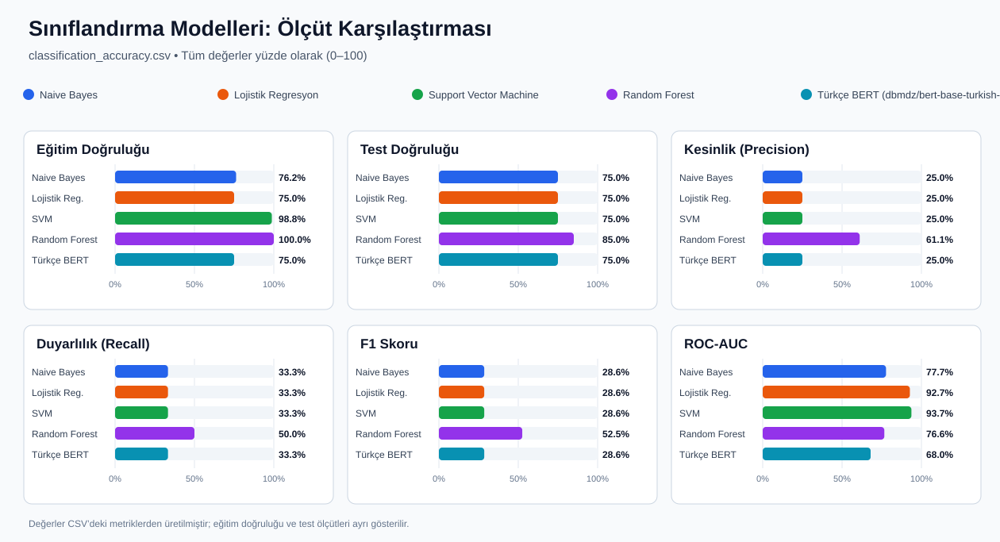

# Amazon iPhone 15 Yorum Analizi

Bu proje kaydedilmiş Amazon yorumlarını çıkarır, Türkçe metin ön işleme
aşamalarını CSV'ye kaydeder ve yorumların içeriğinden duygu sınıflandırması
yapar. Sınıflandırmada yıldız puanı etiket olarak kullanılmaz.

## Gereksinimler

- Python 3.13
- `requirements.txt` içindeki paketler
- Türkçe BERT modeli ilk kullanımda Hugging Face'ten indirilir

PowerShell'de proje klasörüne geçip bağımlılıkları kurun:

```powershell
cd "C:\karışık\amazon_yorum_cekme"
py -3.13 -m pip install -r requirements.txt
```

## 1. Yorumları çıkarma ve işleme

Varsayılan olarak betik
`%USERPROFILE%\Desktop\amazon_yorumlar_files\amazon_yorumları_cekilenler.csv`
dosyasını okur ve proje klasöründe `iphone15_reviews_processed.csv` oluşturur:

```powershell
py -3.13 amazon_iphone15_reviews.py
```

Farklı bir CSV, kaydedilmiş HTML dosyası veya HTML klasörü ve çıktı yolu
belirtilebilir:

```powershell
py -3.13 amazon_iphone15_reviews.py --input "C:\veri\amazon_yorumları_cekilenler.csv" --output ".\iphone15_reviews_processed.csv"
py -3.13 amazon_iphone15_reviews.py --input "C:\veri\amazon_html" --output ".\iphone15_reviews_processed.csv"
```

CSV'de ürün/model sütunu varsa yalnızca temel iPhone 15 yorumları seçilir;
karışık ürün verisinde bu sütun yoksa kaynak CSV önceden filtrelenmiş olmalıdır.
HTML girdisi Amazon yorumlarının içeriklerini barındıran `.html` veya `.htm`
sayfası olmalıdır. İşlenmiş CSV; yorum, puan ve kimlik gibi alanların yanında
küçük harf, token, stop-word temizliği, kök bulma ve lemmatization aşamalarını
da içerir.

## 2. Duygu sınıflandırması

Sınıflandırıcıları eğitmek için:

```powershell
py -3.13 amazon_review_classification.py
```

Etiketler yorum metnindeki olumlu/olumsuz kök öneklerinden çıkarılır. Türkçe
harfler ASCII karşılıklarına çevrilir; örneğin çekimli sözcükler sözlükteki
kök önekleriyle eşleştirilir. “Güzel değil” gibi ifadelerde olumsuzluk
sözcüğü duygu işaretini tersine çevirir. Olumlu veya olumsuz işaret
bulunmayan ya da iki tür işaretin eşit olduğu yorumlar nötr kabul edilir.
Bu etiketler otomatik sözlük etiketleridir; doğruluk puanları insan tarafından
doğrulanmış etiketlere göre değil, sözlük etiketlerine göre hesaplanır.

Veri, sabit tohumla ve sınıf oranları korunarak %80 eğitim / %20 test
kümelerine ayrılır. Naive Bayes, lojistik regresyon, doğrusal SVM ve Random
Forest TF-IDF özellikleriyle eğitilir; Türkçe BERT
(`dbmdz/bert-base-turkish-cased`) ince ayar yapılarak değerlendirilir. Eğitim
doğruluğu ile test doğruluğu, macro kesinlik (precision), duyarlılık (recall),
F1 ve macro one-vs-rest ROC-AUC değerleri `classification_accuracy.csv`
dosyasına yazılır. Değerler 0–1 aralığında kaydedilir. İşlenmiş yorumlar
`iphone15_reviews_processed.csv` dosyasındadır. Bu ölçümler otomatik sözlük
etiketlerine göre hesaplandığından insan doğrulamalı performans olarak
yorumlanmamalıdır.

### Makaledeki gibi hedef tabanlı sıfır-atış duygu analizi

[Koruyan (2025)](https://doi.org/10.38016/jista.1543187), çok dilli
`vicgalle/xlm-roberta-large-xnli-anli` modeliyle sıfır-atış NLI ve çok etiketli
sınıflandırma kullanır; aynı yorumda birden çok kalite boyutunun olumlu
veya olumsuz duygu puanlarını ayrı ayrı hesaplar. Bu projede restoran
boyutları telefona uyarlanarak cihaz kalitesi/tasarım, performans/pil,
ekran/kamera, satıcı/teslimat ve fiyat/değer olarak tanımlanmıştır:

```powershell
py -3.13 amazon_zero_shot_sentiment.py
```

İşlem, her hedef için olumlu ve olumsuz NLI puanlarını
`iphone15_sentiment_analysis.csv` dosyasına yazar ve yerel grafik panelinde
gösterir. Makaledeki gibi üç kelimeden kısa yorumlar bu analiz dışında tutulur.
Varsayılan 0,50 eşiğini iki kutup da aşarsa hedef “karma”, ikisi de aşmazsa
“hedef belirtilmedi” olarak görünür. NLI puanları kalibre edilmiş olasılık veya
doğruluk değildir; bu veri için insan etiketli doğrulama yapılmadığından
modelin gerçek doğruluğu ölçülmüş sayılmaz. Makaledeki restoran başarı
ölçümleri bu iPhone sonuçlarıyla doğrudan karşılaştırılamaz.

İlk çalıştırmada yaklaşık 2,24 GB model ağırlığı Hugging Face'ten indirilir;
sonraki çalıştırmalar yerel önbelleği kullanır. Özel dosya, model veya eşik
belirtilebilir:

```powershell
py -3.13 amazon_zero_shot_sentiment.py --input ".\iphone15_reviews_processed.csv" --output ".\iphone15_sentiment_analysis.csv" --model "vicgalle/xlm-roberta-large-xnli-anli" --threshold 0.5 --batch-size 2
```

Modellerin eğitim/test doğruluğu ve test metriklerini karşılaştıran grafik:



Bag of Words (BoW) ve TF-IDF vektörleştirme yöntemlerini dört klasik model
üzerinde karşılaştırmak ve en baskın terimleri çıkarmak için:

```powershell
py -3.13 amazon_review_classification.py --compare-bow-tfidf
```

Stemming'in klasik TF-IDF modellerine etkisini ölçmek için:

```powershell
py -3.13 amazon_review_classification.py --compare-stemming
```

Karşılaştırma, aynı stratified %80/%20 bölmesini ve aynı yorumdan türetilmiş
sözlük etiketlerini kullanır; iki koşulda stop-word temizliği sabit tutularak
yalnızca kök bulma adımı açılıp kapatılır. Naive Bayes, lojistik regresyon,
doğrusal SVM ve Random Forest test doğruluğu, macro kesinlik/duyarlılık/F1 ve
ROC-AUC değerleri `classification_stemming_comparison.csv` dosyasına yazılır
ve panelde yan yana gösterilir. Etiketler insan doğrulamalı olmadığından bu
metrikler gerçek duygu başarımı değil, otomatik sözlük etiketlerine uyumdur.

Grafiği CSV'den yeniden oluşturmak için:

```powershell
py -3.13 plot_classification_accuracy.py
```

### Yerel grafik paneli

Yorum puanları, Bag of Words (BoW) ve TF-IDF karşılaştırması, sıfır-atış hedef
duygu analizi, aylık yorum eğilimi, model karşılaştırmaları ve yorumların
tamamını tarayıcıda görmek için proje klasöründe paneli başlatın:

```powershell
py -3.13 amazon_review_classification.py --compare-bow-tfidf
py -3.13 amazon_zero_shot_sentiment.py
py -3.13 dashboard.py
```

Tarayıcıda [http://127.0.0.1:8000](http://127.0.0.1:8000) adresini açın.
Panel yalnızca bu bilgisayarda çalışır; grafik verilerini mevcut
`iphone15_reviews_processed.csv`, `classification_accuracy.csv`,
`classification_bow_tfidf_comparison.csv`, `bow_tfidf_top_terms.csv` ve
`iphone15_sentiment_analysis.csv` dosyalarından okur. Yeni yorumlar geldiğinde
analizleri yeniden çalıştırıp sayfayı yenileyin. Sunucuyu terminalde
`Ctrl+C` ile kapatın.

Girdi, çıktı veya BERT modelini değiştirmek için:

```powershell
py -3.13 amazon_review_classification.py --input ".\iphone15_reviews_processed.csv" --output ".\classification_accuracy.csv" --bert-model "dbmdz/bert-base-turkish-cased"
```

### Vercel'e dağıtım

Vercel grafik panelini statik olarak yayımlar; yorum çıkarma, model eğitimi ve
sıfır-atış analizi Vercel sunucusunda çalışmaz. Bu işlemleri yerelde çalıştırıp
panel verisini dağıtımdan önce oluşturun:

```powershell
py -3.13 export_dashboard_data.py
```

`dashboard-data.json` üretilir ve panel bu dosyayı kullanır. Git ile dağıtımda
güncel dosyayı commit edin; Vercel'de bu depoyu içe aktarın. `vercel.json`
framework seçimini **Other** olarak zorlar; Vercel proje ayarlarında framework
hala Python görünüyorsa **Other** seçin. Build komutu ve output directory boş
bırakılabilir. Terminalden dağıtmak için Node.js kurulu olmalı;
proje klasöründe ilk seferde `npx vercel`, yayınlamadan önce de
`npx vercel --prod` komutunu çalıştırın. Yorum veya analiz verileri
değiştiğinde yerel analizleri yeniden çalıştırın,
`py -3.13 export_dashboard_data.py` komutuyla JSON'u güncelleyin ve yeni
dağıtım yapın.

Dağıtım herkese açık bir URL oluşturabilir. JSON dosyası panelde gösterilen
yorum metinlerini ve yorumcu adlarını içerir; dağıtmadan önce yayımlanmasını
istediğiniz veriler olduğundan emin olun.

## Testler

```powershell
py -3.13 -X utf8 -m unittest -v
```

Daha ayrıntılı parametreler, girdiler ve çıktı açıklamaları için
[KULLANIM.md](KULLANIM.md) dosyasına bakın.
